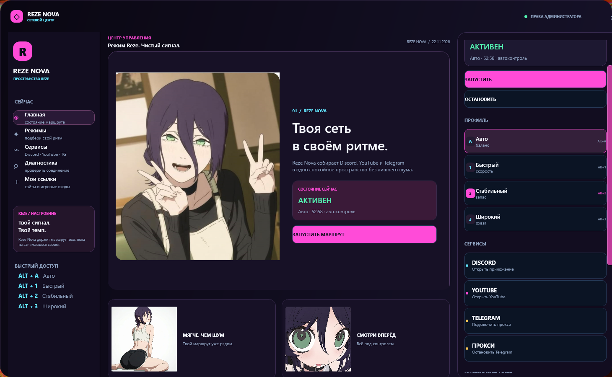

# Reze Nova

<p align="center">
  
</p>

<p align="center">
  <strong>Спокойный центр управления маршрутом для Discord, YouTube, Telegram и своих игровых серверов</strong><br>
  Windows x64 · отдельное ядро WinDivert · четыре режима · диагностика подключения
</p>

<p align="center">
  <a href="https://github.com/Pystoi1173/Reze-Nova/releases"></a>
  <a href="https://github.com/Pystoi1173/Reze-Nova/releases"></a>
  <a href="https://github.com/Pystoi1173/Reze-Nova/issues/new/choose"></a>
</p>

> [!WARNING]
> **Reze Nova находится в стадии закрытого первого beta-теста.** Используйте сборку на своей Windows-системе, сохраняйте важные настройки и сообщайте о проблемах через [Issues](https://github.com/Pystoi1173/Reze-Nova/issues/new/choose). Не публикуйте в обращениях токены, приватные ссылки и персональные данные.

## Быстрые ссылки

| Действие | Ссылка |
| --- | --- |
| Скачать beta-сборку | [Последний релиз Reze Nova](https://github.com/Pystoi1173/Reze-Nova/releases/tag/v0.1.0-beta.1) |
| Сообщить об ошибке | [Создать Issue](https://github.com/Pystoi1173/Reze-Nova/issues/new/choose) |
| Задать вопрос и обсудить проект | [GitHub Discussions](https://github.com/Pystoi1173/Reze-Nova/discussions) |
| Поддержать разработку | [DonationAlerts](https://www.donationalerts.com/r/povetrie) |
| Соседний основной проект | [Reze Zapret](https://github.com/Pystoi1173/Reze-Zapret) |

## Что такое Reze Nova

Reze Nova — отдельное приложение для Windows, которое объединяет системный маршрут и управление сервисами в одном окне. Пользователь выбирает режим, запускает маршрут, видит состояние WinDivert, проверяет соединение и открывает нужный сервис.

Nova использует отдельное ядро `winws2.exe` из zapret2 v1.0.7. Telegram запускается через Flowseal TG WS Proxy v1.11.4. Эти компоненты упаковываются отдельно от интерфейса, а `self-test` проверяет наличие файлов и контрольные суммы runtime.

Reze Nova и Reze Zapret — два основных проекта Reze для разных сценариев.

- [Reze Nova](https://github.com/Pystoi1173/Reze-Nova) — самостоятельный центр управления маршрутом, Discord, YouTube, Telegram, пользовательскими сайтами и игровыми серверами.
- [Reze Zapret](https://github.com/Pystoi1173/Reze-Zapret) — панель управления существующей распакованной сборкой Flowseal с профилями, доменными списками, проверкой подключения, обновлением и ALT-лабораторией.

## Возможности

- Четыре профиля маршрута — `Авто`, `Быстрый`, `Стабильный`, `Широкий`.
- Отдельное ядро `winws2.exe` и контроль конфликта с другим `winws.exe` или `winws2.exe`.
- Понятное сообщение, если WinDivert уже занят другим маршрутом.
- Отдельная проверка страницы YouTube и реального видеопотока через YouTube Player API и `googlevideo.com`.
- Диагностика Discord API, CDN, media, gateway и UDP.
- Кнопка открытия Discord и перезапуск Discord после изменения маршрута.
- Встроенный Telegram-прокси на `127.0.0.1:1443` с проверкой владельца слушателя.
- Окно «Мои ссылки» для сайтов, Steam-ссылок и игровых серверов.
- Пользовательские домены в `include-user.txt`, IP-адреса в `ipset-user.txt`, игровые порты в `game-ports.txt`.
- Автоматический перезапуск маршрута после изменения пользовательских ссылок.
- Горячие клавиши `Alt+A`, `Alt+1`, `Alt+2`, `Alt+3` и `Ctrl+Alt+D`.
- Системный трей, автозапуск Windows, запуск маршрута вместе с Nova и автоматическое восстановление после сбоя.
- Журналы runtime и отдельная карточка целостности компонентов.

## Скриншоты и визуальные материалы

<p align="center">
  
</p>

<p align="center">
  
  
  
</p>

Все изображения проекта перечислены в [ART-CREDITS.md](assets/ui/ART-CREDITS.md). Снимки интерфейса и материалы для описания не содержат пользовательских токенов или личных данных.

## Установка готовой beta-сборки

1. Откройте [страницу Releases](https://github.com/Pystoi1173/Reze-Nova/releases/tag/v0.1.0-beta.1).
2. Скачайте архив beta-сборки Windows x64.
3. Распакуйте архив в папку без кириллицы и без синхронизации с облаком, например `C:\Reze\Nova`.
4. Запустите `Start-Reze-Nova.cmd`, `Reze-Nova.exe ui` или ярлык `язык`.
5. Подтвердите запуск от имени администратора. WinDivert требует повышенные права.
6. Нажмите «Запустить маршрут» и дождитесь статуса «Активен».
7. Откройте Discord или YouTube и проверьте нужный сервис.

Не запускайте несколько программ, которые одновременно используют WinDivert. Если на компьютере уже работает другой `winws.exe` или `winws2.exe`, остановите его через Диспетчер задач или штатное приложение, затем запустите Nova снова.

## Первый запуск и режимы

После запуска Nova показывает состояние маршрута, Telegram, диагностики и целостности runtime. Для обычного использования начинайте с режима `Авто`.

| Режим | Когда выбрать |
| --- | --- |
| `Авто` | Обычная ежедневная работа |
| `Быстрый` | Минимальная задержка в подходящей сети |
| `Стабильный` | Нестабильная сеть и длительные соединения |
| `Широкий` | Расширенный охват сервисов и доменов |

Горячие клавиши работают из других приложений.

- `Alt+A` — выбрать и запустить профиль «Авто».
- `Alt+1` — выбрать и запустить «Быстрый».
- `Alt+2` — выбрать и запустить «Стабильный».
- `Alt+3` — выбрать и запустить «Широкий».
- `Ctrl+Alt+D` — запустить диагностику Discord.

## YouTube и проверка видеопотока

Проверка сети состоит из отдельных этапов. Nova открывает страницу YouTube, обращается к Player API, находит настоящий URL `googlevideo.com/videoplayback` и запрашивает небольшой фрагмент видеопотока. Ответ корневого адреса `googlevideo.com` сам по себе не считается подтверждением работы видео.

Для ручной проверки:

1. Запустите маршрут и дождитесь статуса «Активен».
2. Откройте «Диагностика».
3. Нажмите «Проверить сеть».
4. Посмотрите результаты `YouTube` и `YouTube видео` отдельно.
5. Откройте конкретное видео в браузере, а не только главную страницу.

Если страница YouTube открывается, но видео зависает, сначала проверьте строку `YouTube видео`. Затем убедитесь, что не запущен второй `winws.exe` или `winws2.exe`, и очистите соединение повторным запуском браузера.

## Discord

Кнопка «Открыть Discord» запускает установленный Discord Desktop. «Перезапустить Discord» завершает только процессы Discord и снова открывает приложение после изменения маршрута.

«Диагностика Discord» проверяет API, CDN, `discord.media`, gateway и UDP. Это помогает отличить проблему маршрута от ошибки самого Discord Desktop. Голосовые каналы и демонстрация экрана проверяются отдельным реальным подключением после завершения диагностики.

## Telegram Desktop

1. Нажмите «Подключить Telegram».
2. Nova подготовит собственную конфигурацию и запустит TG WS Proxy.
3. Приложение проверит слушатель `127.0.0.1:1443` и его владельца.
4. Подтвердите подключение в Telegram Desktop.
5. Для остановки нажмите «Остановить Telegram».

Если Telegram продолжает использовать старый прокси после остановки Nova, отключите прокси в настройках Telegram Desktop.

## Мои ссылки

Окно «Мои ссылки» доступно из боковой панели и кнопки на главном экране. Для каждой записи можно указать название, открыть адрес или удалить запись.

Поддерживаются следующие форматы.

| Формат | Результат |
| --- | --- |
| `https://example.com` | Домен попадает в `include-user.txt` |
| `http://example.com` | Домен попадает в `include-user.txt` |
| `steam://connect/123.123.123.123:27015` | Сохраняется Steam-ссылка, IP и порт попадают в игровые списки |
| `123.123.123.123:27015` | Nova сохраняет адрес и открывает его через Steam |

После добавления или удаления записи Nova обновляет пользовательские списки. Если маршрут уже активен, runtime перезапускается с обновлёнными фильтрами.

## Проверка архива и предупреждения Windows

В beta-релизе опубликован готовый архив Windows x64. Его SHA-256 указан в описании релиза и проверен после сборки. Сравнивайте контрольную сумму скачанного файла со значением на странице релиза.

В архив входит сетевой runtime zapret2 с `winws2.exe` и WinDivert. Защитник Windows может показывать предупреждение для сетевых инструментов или официального архива runtime. Не отключайте защиту вслепую. Сначала сравните SHA-256 архива, проверьте источник [официального релиза zapret2](https://github.com/bol-van/zapret2/releases/tag/v1.0.7) и при необходимости отправьте обнаружение в [Microsoft Security Intelligence](https://www.microsoft.com/en-us/wdsi/filesubmission). Уведомления и лицензии сторонних компонентов перечислены в [LICENSES.md](LICENSES.md).

## Что делать при ошибке запуска

### «Другой winws2 уже активен»

WinDivert уже занят другим процессом. Закройте второе приложение, службу или старый тестовый запуск, дождитесь исчезновения `winws.exe` и `winws2.exe` в Диспетчере задач, затем снова нажмите «Запустить маршрут».

### YouTube открывается, но видео не начинается

Проверьте результат `YouTube видео`, перезапустите маршрут и браузер, отключите другие VPN и прозрачные прокси. Если проблема повторяется, создайте [Issue](https://github.com/Pystoi1173/Reze-Nova/issues/new/choose) и приложите лог Nova без приватных данных.

### Nova просит права администратора

Это ожидаемо. Системный маршрут использует WinDivert и требует повышенные права Windows.

### Telegram не подключается

Проверьте, что порт `127.0.0.1:1443` свободен, Telegram Desktop закрыт от старого прокси, а `TgWsProxy.exe` находится рядом с приложением в папке `telegram-proxy`.

## Логи и диагностика

Кнопка «Открыть логи» открывает папку `logs`. Для обращения об ошибке приложите:

- версию beta-сборки;
- версию Windows;
- выбранный режим;
- точные шаги воспроизведения;
- результат «Проверить сеть» или «Диагностика Discord»;
- последний runtime-лог;
- скриншот окна ошибки без личных данных.

Не прикладывайте файлы cookie, токены Discord или Telegram, приватные ссылки, IP-адреса, которые не нужны для воспроизведения, и содержимое личных переписок.

## Ошибки, вопросы и чат

- [Сообщить об ошибке через Issues](https://github.com/Pystoi1173/Reze-Nova/issues/new/choose).
- [Открыть список Issues](https://github.com/Pystoi1173/Reze-Nova/issues).
- [Задать вопрос в Discussions](https://github.com/Pystoi1173/Reze-Nova/discussions).
- [Обсудить Reze Zapret](https://github.com/Pystoi1173/Reze-Zapret/discussions).
- [Поддержать разработку через DonationAlerts](https://www.donationalerts.com/r/povetrie).

Для технической ошибки используйте Issues. Для вопросов, идей и общения используйте Discussions. В каждом обращении укажите, относится ли оно к Nova или к Reze Zapret.

## Сборка из исходников

Для сборки нужен Windows x64 с .NET Framework 4.x и системным компилятором `csc.exe`.

```powershell
.\build.ps1 -Ui -OutputPath dist\Reze-Nova.exe
.\dist\Reze-Nova.exe self-test --runtime-dir .\dist\runtime
.\test.ps1
```

Для консольной сборки:

```powershell
.\build.ps1 -Console -OutputPath dist\Reze-Nova-core.exe
```

`package-runtime.ps1` подготавливает runtime из проверенного официального архива zapret2 v1.0.7. `package-telegram.ps1` подготавливает TG WS Proxy и проверяет SHA-256. `self-test` проверяет комплектность, целостность runtime и собранные профили.

## Компоненты и лицензии

- [zapret2 v1.0.7](https://github.com/bol-van/zapret2/releases/tag/v1.0.7) используется для системного маршрута.
- [Flowseal TG WS Proxy v1.11.4](https://github.com/Flowseal/tg-ws-proxy/releases/tag/v1.11.4) используется для Telegram.
- Уведомления об исходных лицензиях находятся в [LICENSES.md](LICENSES.md).
- Авторские права на визуальные материалы перечислены в [assets/ui/ART-CREDITS.md](assets/ui/ART-CREDITS.md).

## Состояние beta-теста

Первая закрытая beta-версия предназначена для проверки запуска на разных сетях Windows, доставки YouTube-видеопотока, Discord, Telegram, пользовательских сайтов и игровых серверов. Внешний вид и отдельные настройки могут меняться по отзывам тестировщиков.

<p align="center">
  <a href="https://github.com/Pystoi1173/Reze-Nova/releases"></a>
  <a href="https://github.com/Pystoi1173/Reze-Nova/issues/new/choose"></a>
  <a href="https://www.donationalerts.com/r/povetrie"></a>
</p>
